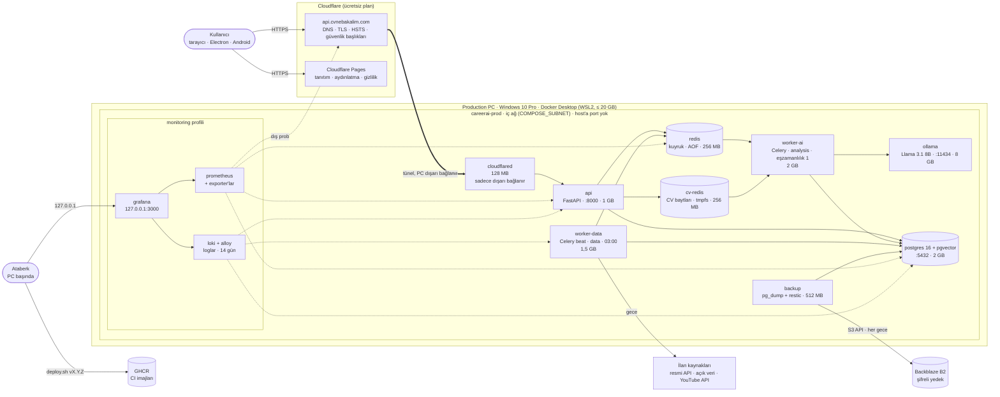
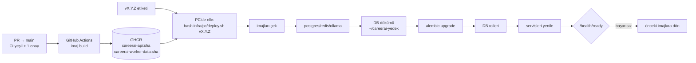

# Deployment: production (PC + Cloudflare Tunnel)

Karar #30 ve [ADR-0004](adr/0004-barindirma-pc-cloudflare-tunnel.md). Production, Ataberk'in bilgisayarında `careerai-prod` adlı Docker Compose projesidir (`infra/pc/compose.yml`). Dışarıdan tek giriş Cloudflare Tunnel; hiçbir servis host'a port açmaz (Grafana yalnızca `127.0.0.1`).

`worker-ai` ve `cv-redis`, Burak'ın `ai/Dockerfile`'ı ve analiz işçisi `main`'e girince compose'a eklenir (`infra/pc/deploy.md`, "Henüz eksik"); diyagram hedef durumu gösterir.

## Ağ sınırları

| Sınır | Kural | Nerede |
|---|---|---|
| İnternet → PC | Gelen port yok. `cloudflared` Cloudflare'e dışarıya bağlanır; istek tünelden `api:8000`'e gelir. Ev IP'si görünmez. | `infra/pc/compose.yml`, `infra/pc/deploy.md` 3. bölüm |
| Tünel → api | Sadece `api.cvnebakalim.com` yayınlanır. Grafana, veritabanı ve Ollama için public hostname eklenmez. Yönetim paneli (`/admin`) Cloudflare Access ile ayrıca korunur. | Cloudflare Zero Trust paneli |
| İstemci IP'si | api `X-Forwarded-For`'a yalnızca projenin alt ağından (`FORWARDED_ALLOW_IPS=COMPOSE_SUBNET`) güvenir; istek sınırları sahte başlıkla aşılamaz. | `infra/pc/compose.yml` (api) |
| PC → dışarı | Yedek (B2), ilan kaynakları, imaj çekme (GHCR) ve Cloudflare. Başka çıkış yok. | — |
| Host → konteyner | Sadece Grafana `127.0.0.1:3000`. Sunum B planında api geçici olarak `127.0.0.1:8100` (`make prod-local`). | `compose.local.yml` |
| Veritabanı rolleri | Uygulama en az yetkili `careerai_app` rolüyle bağlanır; migration sahip rolle; izleme salt okunur `careerai_monitor` (sadece izleme sütunları). | `infra/pc/app-role.sql`, `deploy.sh` (T-075) |

## Deploy akışı

PC'ye dışarıdan deploy erişimi yoktur; CI sadece imaj üretir. Prova için aynı betik `staging` ortamıyla çalışır (`careerai-staging`, ayrı volume'lar).

## Yedek ve geri dönüş

| Ne | Nasıl | Hedef |
|---|---|---|
| Gece yedeği | `backup` konteyneri: `pg_dump` → restic → B2 (şifreli, artımlı) | RPO < 24 saat |
| Deploy öncesi döküm | `deploy.sh` → `~/careerai-yedek/deploy-*.dump` (son 5) | Hatalı migration'dan dönüş |
| Geri yükleme testi | `bash infra/backup/restore-test.sh` (geçici konteynerde) | Aylık |
| Felaket kurtarma | Başka bir ekip bilgisayarında yedekten kurulum + tüneli taşıma (T-087) | RTO < 4 saat |

CV dosyası ve ham CV metni hiçbir yedekte yoktur (karar #9); yedek sadece veritabanıdır.

## Bellek bütçesi

| Servis | Sınır |
|---|---|
| ollama | 8 GB |
| worker-ai | 2 GB |
| postgres | 2 GB |
| worker-data | 1,5 GB |
| api | 1 GB |
| izleme (prometheus, grafana, loki, alloy, exporter'lar) | ~1,8 GB sınır (ölçülen çok daha az) |
| backup | 512 MB |
| redis, cv-redis | 256 MB + 256 MB |
| cloudflared | 128 MB |

Docker Desktop'a (WSL2) en fazla 20 GB verilir; production açıkken geliştirme ortamının Ollama'sı kapatılır. RAM %85'i aşınca Grafana panosunda uyarı görünür (R-09).
