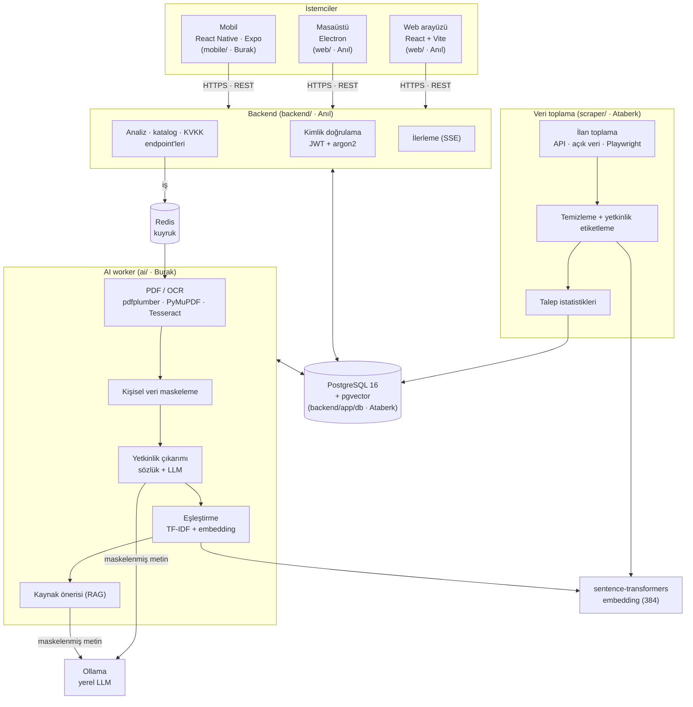

# Component ve Deployment diyagramları

## Component: bileşenler ve sorumluları

Her kutu bir modül; parantez içinde repodaki klasörü ve sahibi var. Oklar veri akışının yönünü gösterir.

**Sınırlar:** İstemciler sadece API ile konuşur. AI worker'a kuyruk üzerinden iş gelir, sonucu veritabanına yazar. Modüller arası veri formatları `contracts/` altındadır (`job_posting` Ataberk → Burak, `analysis_result` Burak → Anıl).

## Deployment

Eski VPS + Caddy diyagramı karar #30 ile geçersiz oldu. Güncel production deployment diyagramı, ağ sınırları, deploy ve yedek akışı: [`docs/architecture/deployment.md`](../architecture/deployment.md).
