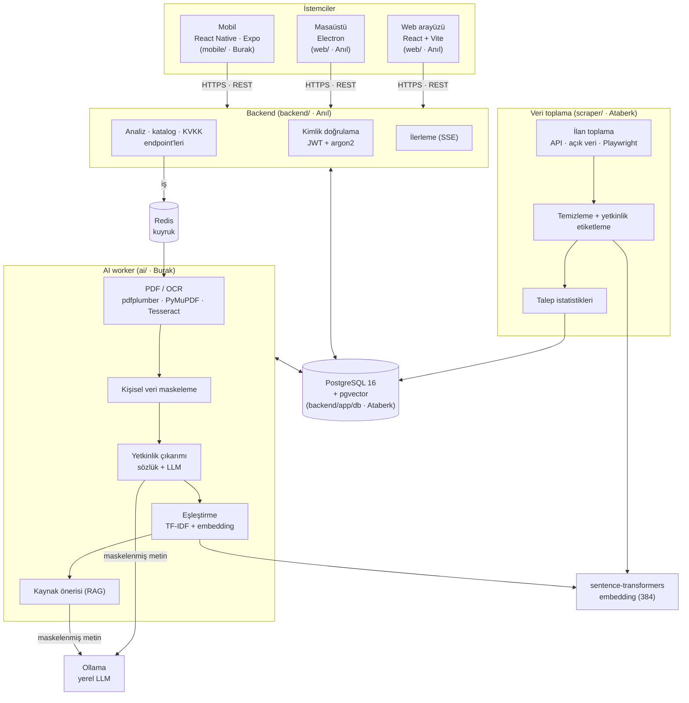
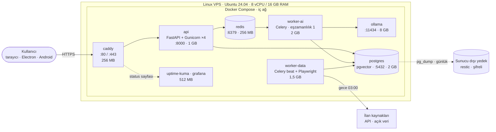

# Component ve Deployment diyagramları

## Component: bileşenler ve sorumluları

Her kutu bir modül; parantez içinde repodaki klasörü ve sahibi var. Oklar veri akışının yönünü gösterir.

**Sınırlar:** İstemciler sadece API ile konuşur. AI worker'a kuyruk üzerinden iş gelir, sonucu veritabanına yazar. Modüller arası veri formatları `contracts/` altındadır (`job_posting` Ataberk → Burak, `analysis_result` Burak → Anıl).

## Deployment: production sunucusu

Tek Linux VPS (8 vCPU / 16 GB RAM), Docker Compose (karar #13). Sadece Caddy dışarıya açıktır.

| Container | Dışa açık mı? | Bellek limiti | Sorumlu |
|---|---|---|---|
| caddy | **Evet** (tek giriş noktası, otomatik HTTPS) | 256 MB | Ataberk |
| api | Hayır | 1 GB | Anıl |
| worker-ai | Hayır | 2 GB | Burak |
| worker-data | Hayır | 1,5 GB | Ataberk |
| ollama | **Kesinlikle hayır** | 8 GB | Burak |
| postgres | Hayır | 2 GB | Ataberk |
| redis | Hayır | 256 MB | Ataberk |
| uptime-kuma / grafana | Sadece status sayfası | 512 MB | Ataberk |

Toplam ~15,5 GB / 16 GB. Ayrıntılar ve ortamlar (lokal / staging / production): `docs/mimari.md`.
