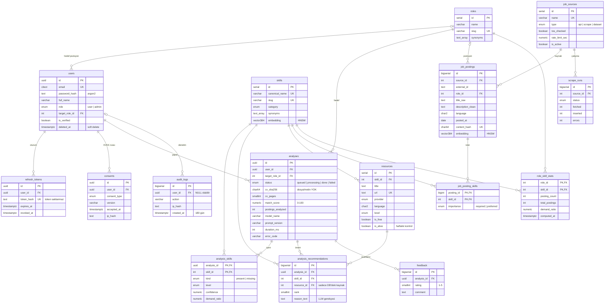

# ERD: veritabanı şeması

> **Kaynak:** `docs/veritabani.md`. Ataberk'in şeması (T-011) kesinleşince onunla karşılaştırılıp güncellenecek. Şemanın kendisi Alembic migration'larıdır; bu diyagram onların resmidir, tersi değil.

Tüm tablolarda `created_at` / `updated_at` vardır; diyagramı sade tutmak için gösterilmedi. **CV dosyası ve ham CV metni hiçbir tabloda yoktur**; analizde sadece `cv_sha256` ve sayfa sayısı tutulur (karar #9).

## Notlar

- **Kullanıcı silinince** (`ON DELETE CASCADE`): oturumlar, rızalar, analizler ve analizlere bağlı yetkinlik / öneri / puan kayıtları silinir. `audit_logs` bağımsız denetim kaydıdır (`user_id` boş olabilir, 180 gün saklanır); silmede ne olacağı T-011'de netleşmeli.
- **İki ayrı dünya:** üst yarı kullanıcı ve analizler (Anıl + Burak yazar), alt yarı ilanlar ve istatistikler (Ataberk'in toplayıcısı yazar). İkisi `skills` ve `roles` tablolarında buluşur.
- **Tip kısaltmaları** (Mermaid sınırı): `text_array` = `text[]`, `vector384` = `vector(384)`, `char64` = `char(64)`, `char2` = `char(2)`.
