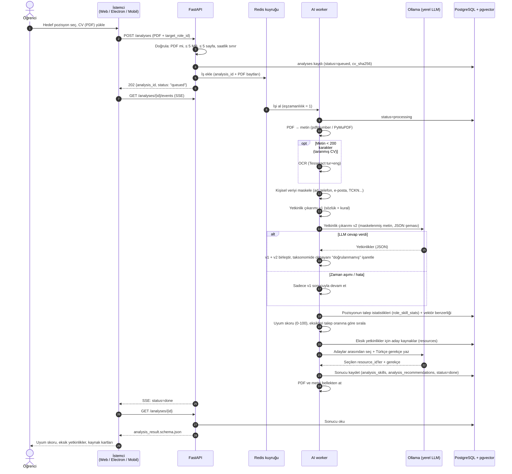

# Sequence diyagramı: CV yükleme → sonuç

Bir analizin baştan sona akışı. CV dosyası ve ham metin hiçbir adımda diske, veritabanına veya loga yazılmaz (karar #9); worker'a bellekte iletilir ve iş bitince bellekten atılır.

## Hata durumları

| Durum | Ne olur | `error.code` |
|---|---|---|
| PDF değil / bozuk / şifreli | API veya worker reddeder, `status=failed` | `PDF_UNREADABLE` |
| > 5 MB veya > 5 sayfa | API reddeder, kuyruğa girmez | `PDF_TOO_LARGE` |
| OCR'dan sonra da metin yok | `status=failed` | `NO_TEXT_FOUND` |
| LLM cevap vermiyor | Sözlük (v1) sonucuyla devam eder, analiz yine `done` olur | — |
| Görevin toplam süresi aşıldı (T-057) | `status=failed` | `LLM_TIMEOUT` |
| Beklenmeyen hata | Kullanıcıya genel mesaj; ayrıntı sadece logda (kişisel veri maskeli) | `INTERNAL` |

Kodlar `contracts/analysis_result.schema.json` ile aynıdır.
