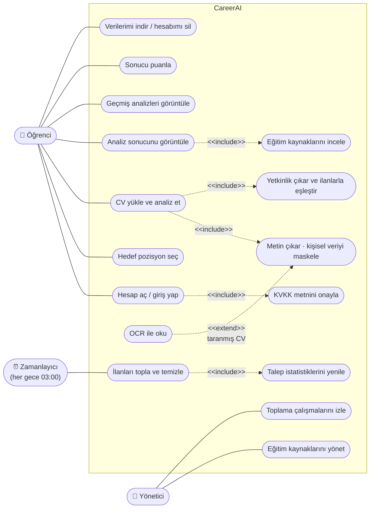

# Use Case diyagramı

Mermaid'de UML use case diyagramı türü yoktur; aynı gösterim akış şemasıyla çizildi: solda aktörler, ortada sistem sınırı içinde kullanım durumları. Kesikli oklar `<<include>>` (her zaman dahil) ve `<<extend>>` (koşullu) ilişkileridir.

## Kullanım durumları

| # | Kullanım durumu | Aktör | Not | API / görev |
|---|---|---|---|---|
| UC1 | Hesap aç / giriş yap | Öğrenci | E-posta doğrulama, şifre sıfırlama dahil | `/auth/*` · T-037 |
| UC2 | KVKK metnini onayla | Öğrenci | Kayıtta zorunlu; onay sürümüyle saklanır (`consents`) | `/auth/register` · T-065 |
| UC3 | Hedef pozisyon seç | Öğrenci | En az 10 pozisyon | `/roles`, `PATCH /users/me` |
| UC4 | CV yükle ve analiz et | Öğrenci | PDF, ≤ 5 MB, ≤ 5 sayfa; kuyruk işi, 1-2 dk | `POST /analyses` · T-038, T-057 |
| UC5 | Analiz sonucunu görüntüle | Öğrenci | Uyum skoru, mevcut/eksik yetkinlikler, talep oranı | `GET /analyses/{id}` · T-053 |
| UC6 | Eğitim kaynaklarını incele | Öğrenci | Linkler sadece veritabanından (karar #10) | T-043 |
| UC7 | Geçmiş analizleri görüntüle | Öğrenci |  | `GET /analyses` |
| UC8 | Sonucu puanla | Öğrenci | 1-5 + yorum; model kalitesini izlemek için | `POST /analyses/{id}/feedback` |
| UC9 | Verilerimi indir / hesabımı sil | Öğrenci | KVKK hakları | `/users/me/export`, `DELETE /users/me` · T-049 |
| UC10 | Metin çıkar · kişisel veriyi maskele | (sistem) | Bellek içi; CV ve ham metin saklanmaz (karar #9) | T-020, T-030 |
| UC11 | Yetkinlik çıkar ve ilanlarla eşleştir | (sistem) | Sözlük + yerel LLM (Ollama); LLM düşerse sözlük sonucu | T-031, T-032, T-042 |
| UC12 | OCR ile oku | (sistem) | Çıkarılan metin < 200 karakterse | T-029 |
| UC13 | Eğitim kaynaklarını yönet | Yönetici | Kaynak ekle / düzenle / kapat | T-063 |
| UC14 | Toplama çalışmalarını izle | Yönetici | `scrape_runs` durumu | T-063 |
| UC15 | İlanları topla ve temizle | Zamanlayıcı | Resmi API → açık veri → izin veren siteler (karar #8) | T-015, T-033 |
| UC16 | Talep istatistiklerini yenile | Zamanlayıcı | `role_skill_stats` | T-045 |
